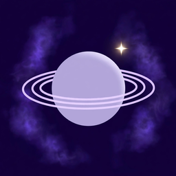
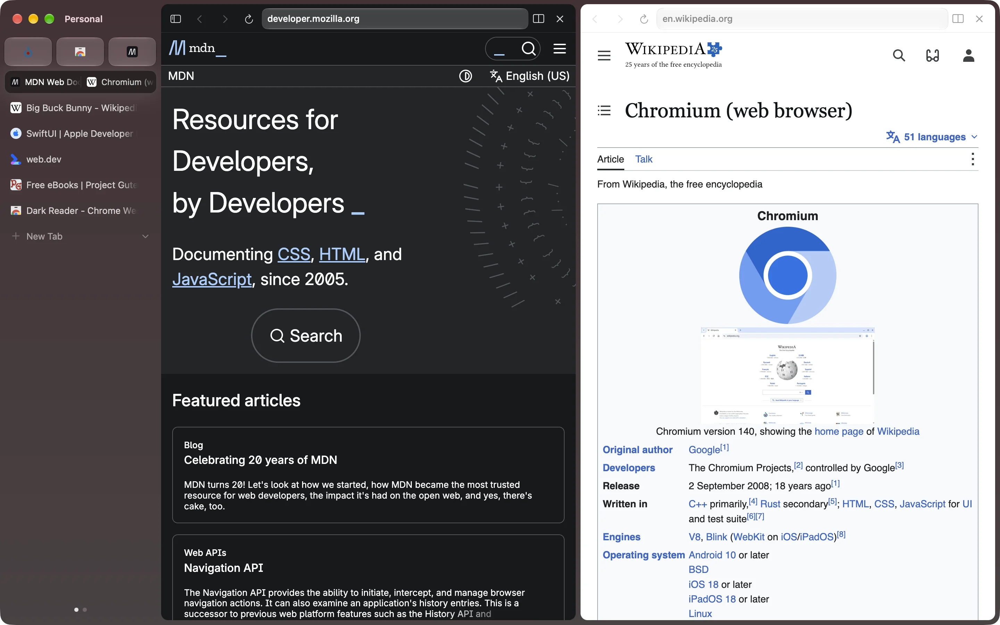
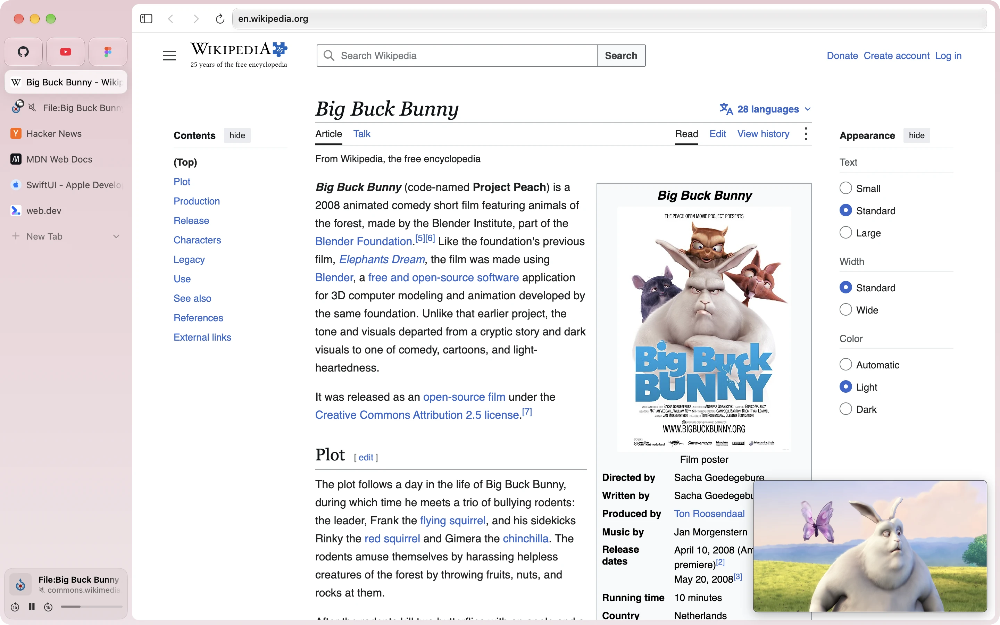

<p align="center">
  
</p>

<h1 align="center">Your universe, in one window.</h1>

<p align="center">
  A fast, private browser on real Chromium.<br>
  Free and open source. Ads and trackers stay out.
</p>

<h3 align="center">
  <a href="https://github.com/TheSatyam-Singh/UniVerse-Project-Browser/actions/workflows/universe-macos.yml">Download UniVerse Project Browser for Mac</a>
</h3>

<p align="center">
  macOS 14 Sonoma or later · Apple Silicon · Unsigned build — right-click the app and choose Open on first launch<br>
  Built by GitHub Actions from this repo. The latest build is the <code>release-unsigned</code> artifact on the newest macOS run.<br>
  <a href="https://github.com/TheSatyam-Singh/UniVerse-Project-Browser">github.com/TheSatyam-Singh/UniVerse-Project-Browser</a>
</p>

<p align="center">
  
</p>

## Lose the toolbar.

Move the address bar into the sidebar and the page runs all the way to the top of the window.


## Two pages, one window.

Drag a tab onto the page. Up to three panes, side by side or stacked.



## Refuses to leave the picture.

Switch tabs mid-video and it floats along in the corner. Go back to its tab and it slips back into the page.



## Your extensions come along.

The Chrome Web Store just works, its button says Add to UniVerse Project Browser, and Sync takes them to your other Macs.


## Ads and trackers stay out.

The full uBlock Origin is built in, cookie banners included. Google’s pings are compiled out. Crash reports are
opt-in and never carry your sites or searches.

## Also in there

- **Work stays at work.** Each profile keeps its own logins, history, extensions and colour. Swipe the sidebar to switch.
- **Little UniVerse.** ⌥⌘N opens a small window with one page and no sidebar.
- **Groups on contact.** Drop a tab on a tab and they’re a group, named for you.
- **Moves in for you.** Bookmarks, history, passwords and logins from Chrome, Safari, Firefox, Arc, Dia and five more. Arc’s spaces, pinned tabs and themes too.
- **Paints like Arc.** Gradient themes per profile: up to three colours, some grain, some blur.
- **Syncs through your iCloud.** End-to-end encrypted, in a folder in your own iCloud Drive. No server of ours in the middle.
- **Command bar.** ⌘L finds tabs, history and bookmarks, does your sums, and knows doc.new and 16 friends.
- **Tidies up.** ⌥⌘K sweeps the tabs you haven’t touched into Recently Cleaned.
- **Clean links.** Copy a link and the tracking junk stays behind.
- **Naps when you do.** Background tabs past your latest five freeze, and sleep after half an hour.
- **Sits still.** Idles under half a percent of CPU with a tab open.
- **Updates itself.** Quietly, then shows you what changed.

## It’s actually Chromium.

Not WebKit. Not Electron. Every window is Chrome’s own, so sites, extensions and DevTools behave like they do in Chrome.

| Part | Details | Status |
| --- | --- | --- |
| Engine | Chromium 157, on Chrome’s own framework. | ✓ Yes |
| De-Googled | Google’s background services stripped out. | ✓ Yes |
| H.264 and AAC | The codecs Chromium leaves out. | ✓ Yes |
| DevTools | Docked, with device mode. Like Chrome. | ✓ Yes |
| Sync | End-to-end encrypted, through your own iCloud Drive. | ✓ Yes |
| Translate | On your Mac. Nothing leaves it. | ✓ macOS 26 |
| Passkeys | Touch ID yes. iCloud Keychain waits on Apple. | ~ Partly |
| Netflix and DRM | Streaming sites open in WebKit, where they play. Widevine in Chromium waits on Google. | ~ Partly |
| Intel Macs | Apple Silicon only. | ✗ No |

<h3 align="center">
  <a href="https://github.com/TheSatyam-Singh/UniVerse-Project-Browser/actions/workflows/universe-macos.yml">Download UniVerse Project Browser</a>
</h3>

<p align="center">
  It’s one drag into Applications.<br>
  The build is unsigned, so right-click the app and choose Open the first time.
</p>

---

## Platforms

Built by GitHub Actions from this repo. All workflows run only when started by hand (Actions → pick a workflow → Run workflow).

| Platform | Status | Built by |
| --- | --- | --- |
| macOS | Shipping — the app in this tree (`apps/browser`, React Native macOS shell on the Chromium framework). Apple Silicon, macOS 14+. | `.github/workflows/universe-macos.yml` (macOS runner) |
| Android | Shipping — the Kotlin app in `apps/android/` (Compose UI, `com.universe.projectbrowser.android`). CI builds debug and release. | `.github/workflows/universe-android.yml` (Ubuntu runner, Temurin Java 21) |
| iOS | Present in the tree (`apps/ios/`), but out of scope for now — do not break it. | `.github/workflows/universe-ios.yml` |
| Windows | Not in this tree — there is no Windows app or Windows workflow yet. | Not wired up |

The typecheck gate is `.github/workflows/universe-typecheck.yml`.

## Signed builds: secrets to add on GitHub

Signed builds need secrets the repo does not ship. Add them under the repo’s
**Settings › Secrets and variables › Actions** (never commit a secret, and never paste one
into a chat, an issue or a log). The names below are the ones the workflows already read.

**macOS — Developer ID + notarization + Sparkle** (read by `universe-macos.yml`):

| Secret | What it is |
| --- | --- |
| `MACOS_CERTIFICATE_P12` | Your Apple Developer ID Application certificate, exported as a base64 `.p12` |
| `MACOS_CERTIFICATE_PASSWORD` | The password for that `.p12` |
| `MACOS_PROVISIONING_PROFILE` | The provisioning profile for the app (base64) |
| `SPARKLE_ED_PRIVATE_KEY` | The Sparkle EdDSA private key that signs the appcast (the public key is already in the app’s `Info.plist` as `SUPublicEDKey`) |
| `NOTARY_KEY_P8` | The App Store Connect API key (`.p8`) for `notarytool` |
| `NOTARY_KEY_ID` | That API key’s key ID |
| `NOTARY_ISSUER` | That API key’s issuer ID |
| `HOMEBREW_TAP_TOKEN` | A token that can push to the Homebrew tap repo, for `update-tap.sh` |

Without the macOS secrets, `universe-macos.yml` still builds, but it cannot sign, notarize or publish a
release; dry runs pass with `ALLOW_MISSING_NOTARY=1`.

**Android — keystore** (for a signed release build; `universe-android.yml` currently builds
`assembleRelease` unsigned, and reads no secrets yet):

| Secret | What it is |
| --- | --- |
| `ANDROID_KEYSTORE_BASE64` | Your release keystore file, base64-encoded |
| `ANDROID_KEYSTORE_PASSWORD` | The keystore’s password |
| `ANDROID_KEY_ALIAS` | The key alias inside the keystore |
| `ANDROID_KEY_PASSWORD` | That key’s password |

Wire these into `universe-android.yml` (a signing step before `assembleRelease`) before publishing a
signed APK/AAB.

**Windows — optional, for when the Windows shell lands:**

| Secret | What it is |
| --- | --- |
| `WINDOWS_CERTIFICATE_PFX` | A code-signing certificate (`.pfx`, base64) for the Windows installer, if you sign it |
| `WINDOWS_CERTIFICATE_PASSWORD` | That certificate’s password |

No Windows secret is needed until the Windows shell and its workflow exist.

---

# Build it yourself

A macOS browser that looks and feels like [Dia](https://diabrowser.com): Chrome's own framework from our
patched Chromium with our layer on top (UniVerseCore), an Expo + React Native macOS shell, and Metal shaders
reconstructed from Dia's own New Tab effects.

```
apps/
  browser/            Expo + react-native-macos app (UI in src/, Xcode project in macos/)
packages/
  universecore/          The engine: Chromium 157's framework with our layer (Chrome tabs hosted in our views), JS API in src/
  shell/              Native menu bar + shortcuts → JS, windows, SF Symbols, native primitives
  shaders/            Metal: New Tab effects + grained OKLab window backdrop
  import/             Import from other browsers (bookmarks, history, passwords, Arc spaces)
  core/               Pure TS: omnibox input → URL, suggestions, Dia-style breadcrumbs (tested)
```


## Run it

Requires Xcode 26+, CocoaPods, Node 24 (pinned in `.nvmrc`), pnpm 11.

```bash
pnpm install
```

The engine (Chrome's framework, built from our patched Chromium) comes prebuilt: with no local engine build, the app's
build downloads the one matching your checkout's `engine/` (about 110 MB, once; Apple Silicon only) and checks it
against `packages/universecore/prebuilt-engines.tsv`. Every release whose engine changed publishes one. If `main`'s engine
is newer than the last release's, work from a release tag (`v0.2.30`, say), or run
`packages/universecore/scripts/fetch-engine.sh --nearest` to build against the newest prebuilt anyway. Passkeys and saved
cards need our team ID and won't work in a build signed by anyone else.

To change the engine itself (anything under `engine/`), build it from source: Chrome's framework from our patched
Chromium tree in `~/chromium-build` (Chromium 157.0.8103.50 with the patch series in `engine/patches`;
`docs/engine-build.md` › "Rebuilding", then `engine/chromium/apply.sh`,
`engine/universecore/apply.sh` and `autoninja -C out/Release_GN_arm64 chrome_framework`; the first build takes about 2
hours). The app's build stages it from there when it exists.

```bash
pnpm pods
```

In one terminal, start Metro:

```bash
pnpm dev
```

In another, build and launch the Debug app (on its own data, `~/Library/Application Support/UniVerse Project Browser Dev`, or
`UNIVERSE_DATA_DIR`):

```bash
pnpm macos
```

Other tasks: `pnpm typecheck`, `pnpm test`, `pnpm shaders:check` (compiles the embedded Metal offline),
`scripts/agent/build-app --config Release` (a Release `.app` with a Hermes bytecode bundle in
`apps/browser/build-<name>`, under the shared build locks; `--help`).
Signed releases (DMG, Sparkle zip and appcast) are built by the Release workflow with `scripts/release.sh`, see
`docs/releasing.md`.

Shortcuts: ⌘T new tab, ⌘L command bar, ⌘W close, ⇧⌘T reopen, ⌘S sidebar, ⌘[ / ⌘] back/forward,
⌘R reload, ⌘1–⌘9 select tab, ⌃Tab cycle.

## How Dia's New Tab light works

Dia 1.50 turns this light off along with its rebrand (a painted mark, a single-colour power-up band
and a halo around the bar; `docs/dia-spec.md` › "1.50 Sunglow"), and so does UniVerse Project Browser. The
reconstruction left the tree with it: `git show f2c0e251:packages/shaders/ios/AreaLightView.swift`.

These findings come from disassembling the Metal libraries in `Dia.app` (v1.49.1) with
`xcrun metal-objdump`. `BoostBrowser_PowerUp.bundle/default.metallib` contains
`breathingAreaLightFragment`, which the Swift class `NewTabPage.NewTabAreaLightView` hosts. The
reconstruction was `AreaLightView.swift` (above).

- **The command bar is a light source.** Dia models the bar as a rounded-rectangle area light floating
  `lift` points above the page. Each pixel receives the closed-form irradiance of that rectangle: the
  solid-angle formula, one `atan` term per corner, times 1/2π. Rounded corners subtract (1 − π/4) of
  each corner square. The result is a physically correct penumbra: a higher lift gives a softer, wider
  glow.
- **Falloff** is reshaped from inverse-square to `(h/d)^falloff`, where `d` is the distance to the
  emitter's rounded-rect surface rather than to its centre.
- **Colour** is Dia's brand spectrum (`ProgressBarColor2…7` in its asset catalog):
  blue `#0358F7`, steel `#5092C7`, lavender `#E1E1FE`, yellow `#FFD400`, orange `#FA3D1D` and magenta
  `#FD02F5`. It is laid out as a wrapping, slightly diagonal gradient that scrolls every 20 s. IQ's 2D
  simplex noise warps the gradient under the bar, and the warp fades out into the penumbra.
- **Dark mode** treats the light as HDR emission and applies the Hable/Uncharted-2 filmic tonemap
  (white point 11.2), with alpha set to Rec.709 luminance. **Light mode** keeps the flat palette
  colour and uses the irradiance as opacity.
- **Finishing:** alpha fades over the top 50 pt and bottom 200 pt of the view, and ±3/255 triangular
  dither (Dave Hoskins' `hash12`) prevents banding in the long soft falloff.
- **Animation:** the shader itself only scrolls the colours. The lift-off intro and the slow
  "breathing" come from the CPU, which animates `lift` and `intensity`. Those curves live in Dia's
  Swift code, so the ones here (quartic ease-out over 1.1 s, ±7% intensity on a 5.5 s sine) are my
  approximation.

The **window backdrop** comes from `ARC_WindowThemeUI.bundle`
(`gradientFragment` + `renderFragment`). Gradient stops are stored and mixed in **OKLab**, then
converted to linear sRGB and gamma-encoded in the shader. A tiled grain texture is then
multiply-blended on top. `WindowBackdropView` does the same with procedural grain.

Only math and colour values are reused. No Dia images, fonts or binaries are copied into this repo.

## Architecture notes

- **Why Expo SDK 54:** `react-native-macos` tops out at 0.81, which pairs with Expo SDK 54 (whose
  `ExpoAppDelegate` / `ExpoReactNativeFactory` have macOS code paths).
- **Legacy architecture.** react-native-macos 0.81's Fabric support is experimental, so the app runs on
  the legacy architecture. One consequence: Expo's legacy view-manager adapter instantiates a module's
  *first* view class for every view it declares, so each native view has its own module.
- **Metro, not `expo start`.** Metro runs through the react-native-macos CLI. `metro.config.js`
  redirects `react-native` → `react-native-macos` for `platform=macos`, because defining our own
  `resolveRequest` replaces the redirect the CLI would install.
- **No Reanimated.** It has no macOS build for 0.81; animations use RN's `Animated`.
- **Monorepo paths.** pnpm is set to `nodeLinker: hoisted` because CocoaPods and Metro resolve
  `react-native-macos` by path. The Podfile rewrites `REACT_NATIVE_PATH` to the hoisted location and
  raises every pod's deployment target to 14.0, since Xcode 26+ rejects the 11.0 some Expo pods declare.
- **Native subviews** are sized in `setFrameSize`, not `layout()`. RN macOS assigns frames directly and
  never autoresizes subviews.
- **Shaders** are Metal source embedded in Swift and compiled at runtime (once per class, cached). This
  keeps the pods free of a metallib build phase.

## Status

Feature parity with Dia (everything but its AI) is tracked row by row in
[docs/dia-feature-parity.md](docs/dia-feature-parity.md); releases and their notes are at
[https://github.com/TheSatyam-Singh/UniVerse-Project-Browser/releases](https://github.com/TheSatyam-Singh/UniVerse-Project-Browser/releases).

## License

UniVerse Project Browser is derived from [Ardia](https://github.com/mantrakp04/ardia), and is
distributed under the [GNU General Public License v3](LICENSE). It cannot be closed-sourced:
its engine carries Helium's GPL-3.0 patches.

- UniVerse's own source files are under the [Apache License 2.0](LICENSE.Apache-2.0) (copyright
  Mantra Patel; see [NOTICE](NOTICE) for UniVerse's attributions). Apache-2.0 code may be combined
  into a GPL-3.0 work, so those files keep that licence on their own.
- The browser builds on Chromium, carries a few of the Chromium Embedded Framework's patches to
  Chromium (BSD-3-Clause), and bundles uBlock Origin, each under its own license; see
  [NOTICE](NOTICE).

Corresponding Source: every release's notes on GitHub
(https://github.com/TheSatyam-Singh/UniVerse-Project-Browser/releases) link the repository at
that release's tag, with the engine's patch series and build scripts (`engine/`,
`docs/engine-build.md`), and the release's `UniVerseCore-<tree>-source.tar.xz`, which holds the
Helium sources the engine was built from and says where Chromium's source is.
