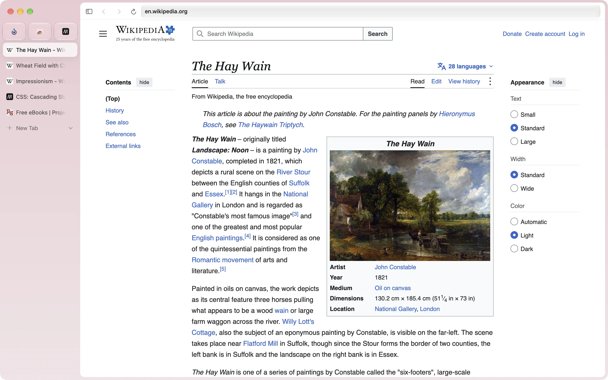
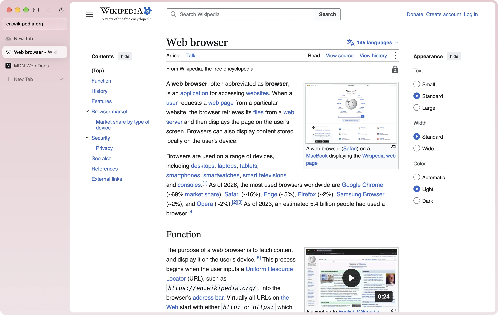
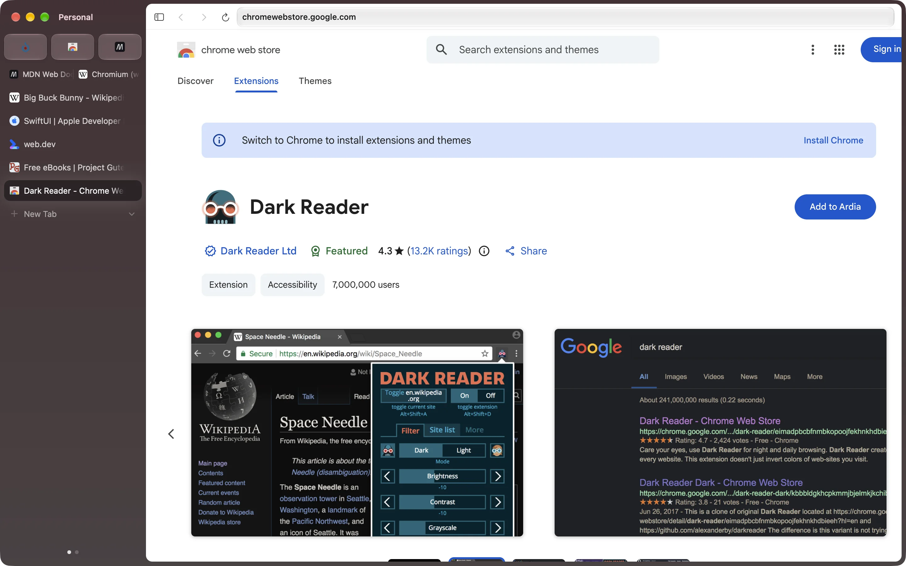
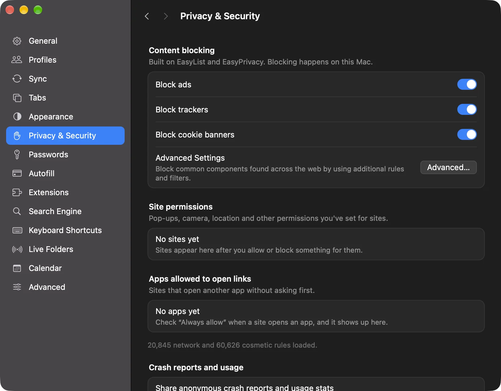

<p align="center">
  
</p>

<h1 align="center">UniVerse Project Browser</h1>

<p align="center">
  One browser for macOS, Windows and Android.<br>
  Real Chromium under the hood, an Arc-style sidebar on top, and Nook's brains inside.
</p>

<p align="center">
  <a href="https://github.com/TheSatyam-Singh/UniVerse-Project-Browser/releases">Download for Mac</a> ·
  <a href="https://github.com/TheSatyam-Singh/UniVerse-Project-Browser/releases">Download for Windows</a> ·
  <a href="https://github.com/TheSatyam-Singh/UniVerse-Project-Browser/releases">Download for Android</a>
</p>

<p align="center">
  
</p>

## Why another browser

Most browsers make you choose: Chrome's compatibility or a nicer interface. UniVerse Project Browser refuses the trade. It runs the real Chromium engine, so every site, extension and DevTools panel behaves exactly like Chrome — and it wraps that engine in a sidebar-first interface with the features that made Arc and Nook worth using: spaces, tab archive, split view, a built-in blocker, and an AI assistant that can actually do things in your tabs.

It is free and open source, and it stays that way: the engine carries GPL-3.0 patches, so this browser cannot be closed-sourced.

## The sidebar is the browser

No top toolbar. The address bar lives in the sidebar, tabs stack down the side, and the page gets the whole window.



- **Spaces** — separate logins, history, extensions and themes per space. Work stays at work.
- **Pinned tiles** — your daily sites, one click away, always in the same place.
- **Tab groups** — drop a tab on a tab and it becomes a group, named for you.


## Two pages, one window

Drag a tab onto the page and it splits. Up to three panes, side by side or stacked, each a full live page.


## Video that follows you

Switch tabs mid-video and it floats along in a small window in the corner. Go back to its tab and it slips back into the page — with a seek bar, so you never lose your place.


## Your extensions come along

The Chrome Web Store just works. The button says Add to UniVerse Project Browser, and sync carries your extensions to your other machines.



## Ads and trackers stay out

The full uBlock Origin is built in, cookie banners included. Google's background services are compiled out of the engine. Crash reports are opt-in and never carry your sites or searches.



## The Nook parts

This browser is a merge of two codebases, and the Nook half brings the quiet productivity features:

- **Tab archive** — tabs you haven't touched are swept into an archive automatically, instead of piling up. Nothing is ever lost, it's just filed away.
- **SponsorBlock and tweaks** — skip sponsored segments on YouTube, plus per-site tweaks for YouTube, Facebook and Reddit, and Boosts that restyle sites your way.
- **Tidy Downloads** — downloads sorted and named without the mess.
- **Per-site zoom** — each site remembers its own zoom level.
- **Full-text history** — search what pages actually said, not just their titles.
- **Clean links** — copy a link and the tracking parameters stay behind.
- **Command bar** — ⌘L finds tabs, history and bookmarks, does your sums, and opens new docs.
- **Little UniVerse** — ⌥⌘N opens a small window with one page and no sidebar.

## An assistant that works in your tabs

⌘J opens the AI assistant. It can read the page you're on, summarise it, organise your tabs, and run tools through a local MCP server. It talks to Gemini, OpenRouter, Ollama or any OpenAI-compatible model — pick your provider in Settings. Apple Intelligence tab organising arrives with macOS 26.

## Three platforms, one repo

| Platform | What ships | How it builds |
| --- | --- | --- |
| macOS | The full browser: React Native macOS shell on the Chromium framework. Apple Silicon, macOS 14+. | `universe-macos.yml` |
| Android | Native Kotlin app with the system WebView as its engine, Compose UI, SponsorBlock and multi-select tabs. | `universe-android.yml` |
| Windows | Native WinUI 3 + WebView2 shell. MSIX installer and portable zip. Chrome extensions are not in v1. | `universe-windows.yml` |
| iOS | In the tree, but out of scope for this merge — simulator CI only. | `universe-ios.yml` |

Every push to `master` builds all four on GitHub Actions. Typecheck and tests run on every push too (`universe-typecheck.yml`).

## Get it

Releases live at [github.com/TheSatyam-Singh/UniVerse-Project-Browser/releases](https://github.com/TheSatyam-Singh/UniVerse-Project-Browser/releases). Nightly builds carry the day's fixes; stable releases go through the full smoke and performance run first.

- **Mac:** download the DMG, drag it into Applications. Or `brew install TheSatyam-Singh/tap/universe-project-browser`.
- **Windows:** download the MSIX or the portable zip.
- **Android:** download the APK from the release.

## Build it yourself

You need Xcode 26+, CocoaPods, Node 24 and pnpm 11 for the Mac app.

```bash
pnpm install
pnpm pods
```

Start Metro in one terminal:

```bash
pnpm dev
```

Build and launch the Debug app in another:

```bash
pnpm macos
```

The Chromium engine comes prebuilt (about 110 MB, downloaded once, Apple Silicon only) and is checked against `packages/universecore/prebuilt-engines.tsv`. Building the engine from source takes around 2 hours the first time — see `docs/engine-build.md`.

Other useful commands: `pnpm typecheck`, `pnpm test`, `pnpm shaders:check`.

Shortcuts: ⌘T new tab, ⌘L command bar, ⌘W close, ⇧⌘T reopen, ⌘S sidebar, ⌘[ / ⌘] back and forward, ⌘R reload, ⌘1–⌘9 select tab, ⌃Tab cycle tabs.

## Signed builds

The workflows build unsigned with no setup at all. Signing and publishing need secrets, added under the repo's **Settings › Secrets and variables › Actions**. Never commit a secret, and never paste one into a chat, an issue or a log.

**macOS** — Developer ID, notarization and Sparkle updates:

| Secret | What it is |
| --- | --- |
| `MACOS_CERTIFICATE_P12` | Developer ID Application certificate, base64 `.p12` |
| `MACOS_CERTIFICATE_PASSWORD` | Password for that `.p12` |
| `MACOS_PROVISIONING_PROFILE` | Provisioning profile for the app, base64 |
| `SPARKLE_ED_PRIVATE_KEY` | Sparkle EdDSA private key that signs the appcast |
| `NOTARY_KEY_P8` | App Store Connect API key (`.p8`) for `notarytool` |
| `NOTARY_KEY_ID` | That API key's key ID |
| `NOTARY_ISSUER` | That API key's issuer ID |
| `HOMEBREW_TAP_TOKEN` | Token that can push to the Homebrew tap repo |

Without these, the macOS workflow still builds — it just can't sign, notarize or publish a release.

**Android** — release keystore (the workflow signs the release only when all four are present, otherwise it uploads the unsigned APK and AAB):

| Secret | What it is |
| --- | --- |
| `ANDROID_KEYSTORE_BASE64` | Release keystore file, base64-encoded |
| `ANDROID_KEYSTORE_PASSWORD` | The keystore's password |
| `ANDROID_KEY_ALIAS` | The key alias inside the keystore |
| `ANDROID_KEY_PASSWORD` | That key's password |

**Windows** — optional, for signing the MSIX:

| Secret | What it is |
| --- | --- |
| `WINDOWS_CERT_PFX_BASE64` | Code-signing certificate (`.pfx`, base64) |
| `WINDOWS_CERT_PASSWORD` | That certificate's password |

## Under the hood

- **Engine:** Chromium 157 on Helium's de-Googled patches, with H.264 and AAC included. DevTools docked, with device mode, like Chrome.
- **Shell:** Expo 54 + React Native macOS 0.81, with Metal shaders for the New Tab effects and grained window backdrop.
- **Sync:** end-to-end encrypted, through a folder in your own iCloud Drive. No server in the middle.
- **Import:** bookmarks, history, passwords and logins from Chrome, Safari, Firefox, Arc, Dia and more — including Arc's spaces, pinned tabs and themes.
- **Translate:** on-device, on macOS 26. Nothing leaves the machine.
- **Passkeys:** Touch ID works; iCloud Keychain waits on Apple.
- **Streaming and DRM:** Netflix and friends open in WebKit, where they play. Widevine in Chromium waits on Google.

## License

UniVerse Project Browser is derived from [Ardia](https://github.com/mantrakp04/ardia) and [Nook](https://github.com/nook-browser/Nook), and is distributed under the [GNU General Public License v3](LICENSE).

- Ardia's own source files are under the [Apache License 2.0](LICENSE.Apache-2.0) — see [NOTICE](NOTICE) for attributions.
- Nook's code is GPL-3.0, with its copyright notices kept.
- It builds on Chromium, carries Chromium Embedded Framework patches (BSD-3-Clause), and bundles uBlock Origin, each under its own license — see [NOTICE](NOTICE).

Corresponding Source: every release's notes link the repository at that release's tag, with the engine's patch series and build scripts (`engine/`, `docs/engine-build.md`).
